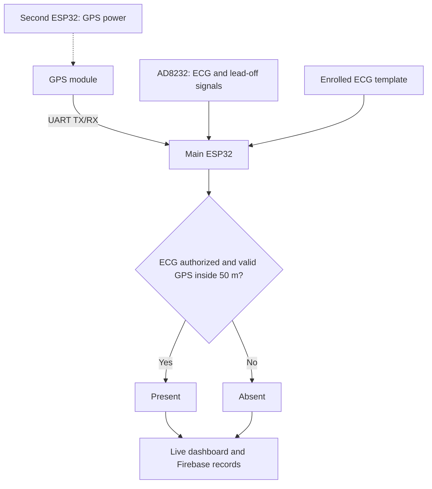

<a id="top"></a>

<div align="center">

# Smart Wearable for Secure and Automated Attendance Tracking

**ECG wearer verification · GPS geofencing · Live attendance monitoring**

An ESP32-based prototype that combines an enrolled ECG profile with a 50-metre GPS geofence to determine attendance.

[About](#about-the-project) · [How It Works](#how-it-works) · [Hardware](#hardware-and-wiring) · [Setup](#getting-started) · [Limitations](#current-limitations)


</div>

## Project Demonstration


*Simulated demonstration with fictional people, showing ECG verification, the 50-metre geofence, and disconnected electrodes.*

<details>
<summary>Table of Contents</summary>

- [About the Project](#about-the-project)
- [How It Works](#how-it-works)
- [ECG Enrollment and Verification](#ecg-enrollment-and-verification)
- [Hardware and Wiring](#hardware-and-wiring)
- [Built With](#built-with)
- [Source Files](#source-files)
- [Getting Started](#getting-started)
- [Usage](#usage)
- [Firebase Records](#firebase-records)
- [Current Limitations](#current-limitations)
- [Roadmap](#roadmap)
- [Contributing](#contributing)
- [License](#license)
- [Contact and Acknowledgments](#contact-and-acknowledgments)

</details>

## About the Project

Manual attendance takes time, while a location-only check does not establish who is carrying a device. This project explores combining two signals: whether the connected wearer matches an enrolled ECG profile, and whether the device is within an allowed area.

The prototype uses an AD8232 ECG sensor and a GPS module. The main ESP32 processes both signals, hosts a browser dashboard, and writes attendance information to Firebase Realtime Database. A second ESP32 supplies power to the GPS module in the physical prototype; GPS data reaches the main ESP32 through UART TX/RX.

The documented geofence is a **circle with a 50-metre radius around a configurable centre**. It is not a campus boundary polygon.

### Features

- ECG feature extraction using 10-second analysis windows.
- Enrollment from recorded ECG features using Python, pandas, and NumPy.
- On-device comparison with the enrolled statistical profile.
- Electrode-disconnection detection using the AD8232 lead-off pins.
- GPS distance calculation and inside/outside geofence status.
- Attendance determined by the combination of ECG and GPS status.
- A local dashboard with a map, verification score, attendance state, and duration counters.
- Firebase current-state records, dated summaries, and state-transition sessions.

## How It Works



The computer displays the dashboard served by the main ESP32. The ESP32 itself sends the Firebase requests; the computer is not required as a relay for those writes.

| GPS condition | ECG condition | Attendance decision |
|---|---|---|
| Valid fix inside or on the 50 m boundary | Authorized | Present |
| Valid fix inside the boundary | Unauthorized, disconnected, or unknown | Absent |
| Valid fix outside the boundary | Any | Absent |
| No valid GPS fix | Any | Absent |

The firmware retains a recent GPS fix for up to approximately five seconds. The browser refreshes every 15 seconds, so its display is periodic rather than instantaneous.

## ECG Enrollment and Verification

### Enrollment

The project workflow collects ECG features, stores them in Firebase, and exports them for enrollment. The supplied notebook begins with a CSV export; it does not acquire the ECG signal or upload the training data itself.

The notebook normalizes column names, converts values to numeric form, removes missing and invalid values, and filters implausible feature rows. It then calculates a mean and standard deviation for each feature.

| Feature | Meaning |
|---|---|
| `beats` | Detected peak count within the analysis window |
| `mean_rr_ms` | Mean interval between detected peaks, in milliseconds |
| `std_rr_ms` | Standard deviation of the peak intervals |
| `mean_peak` | Mean detected peak amplitude in ADC units |
| `std_peak` | Standard deviation of detected peak amplitudes |
| `energy` | Mean squared ADC sample value |

### On-device verification

For each feature, the firmware subtracts the enrolled mean and divides by the enrolled standard deviation. It squares those standardized differences, adds them, and takes the square root:

$$
D = \sqrt{\sum_{i=1}^{6}\left(\frac{x_i-\mu_i}{\sigma_i}\right)^2}
$$

A valid feature window is classified as authorized when its distance is at or below the configured threshold. The notebook suggests a threshold from the enrollment distances using their mean plus three standard deviations.

This is a **single-person statistical template model**. The uploaded notebook does not train a neural network, random forest, or multi-person classifier. The standalone ECG sketches use the same distance-based approach, with slightly different peak-detection settings from the combined sketch; enrollment and verification should use matching extraction settings.

A low score means the window resembles the enrollment profile. It is not a probability or a measured authentication accuracy.

## Hardware and Wiring

| Component | Role |
|---|---|
| Main ESP32 | ECG acquisition, GPS reception, verification, attendance logic, web server, and Firebase requests |
| Second ESP32 | GPS power supply in the demonstrated prototype |
| AD8232 and electrodes | ECG acquisition and lead-off detection |
| UART GPS module | Latitude and longitude measurements |
| Computer or phone | Browser access to the ESP32 dashboard |

### Signal connections in the combined sketch

| Module signal | Main ESP32 pin |
|---|---|
| AD8232 OUTPUT | GPIO36 / VP |
| AD8232 LO+ | GPIO34 |
| AD8232 LO− | GPIO35 |
| GPS TX | GPIO16 / UART2 RX |
| GPS RX | GPIO17 / UART2 TX |
| Signal ground | Common ground across the communicating modules and boards |

GPS UART is configured for **9600 baud**. USB Serial Monitor is configured for **115200 baud**. Confirm the exact module's supply voltage and UART logic levels before wiring; module-specific power pins are not established by the source files.

The second board is the power arrangement used for this prototype. The two-board setup is not presented as a universal ESP32 requirement.

## Built With

| Layer | Technologies |
|---|---|
| Firmware | Arduino C++, ESP32 Arduino core |
| GPS parsing | TinyGPSPlus |
| Networking | WiFi, WebServer, HTTPClient, WiFiClientSecure |
| Enrollment | Python, Jupyter, pandas, NumPy |
| Storage | Firebase Realtime Database REST endpoints |
| Dashboard | HTML, CSS, JavaScript, Leaflet, OpenStreetMap |
| Time | NTP with an India UTC+05:30 offset |

## Source Files

The supplied project files have the following roles. Publish sanitized copies after the credential and biometric-data review.

| File | Purpose |
|---|---|
| `best_working_code_proper_ecg_gps_firebase_absent_present.ino` | Combined attendance firmware; main implementation |
| `IOT_ML_VIRAJ.ipynb` | CSV cleaning, ECG template fitting, and threshold suggestion |
| `Final_ml_application_identification.ino` | Standalone ECG verification firmware |
| `web_interface_viraj_verification.ino` | ECG-only verification dashboard firmware |

These sketches are alternative programs. **Open and upload one sketch at a time**, with each sketch in its own Arduino folder of the same name. Combining them in a single sketch folder would introduce duplicate definitions.

## Getting Started

### Prerequisites

- The hardware listed above and a suitable power arrangement.
- Arduino IDE with ESP32 board support and the TinyGPSPlus library.
- Python and a Jupyter environment for the enrollment notebook.
- A Wi-Fi network and a Firebase Realtime Database under your control.
- Recorded enrollment features from the intended wearer.

### Enrollment setup

1. Collect enrollment windows using the same feature-extraction settings intended for verification. The collection/upload sketch is not included in the supplied source set.
2. Export the feature records to CSV and keep the export private.
3. Install the notebook dependencies:

   ```bash
   python -m pip install pandas numpy jupyter
   ```

4. Open `training/IOT_ML_VIRAJ.ipynb`. Set the `ECG_CSV_PATH` environment variable to your private CSV, or place it at `training/data/enrollment.csv` when running from the training folder.
5. Run the notebook and inspect the number of retained rows and the distance statistics.
6. Transfer the six means, six standard deviations, and chosen threshold into your private firmware configuration. Validate with separate authorized and unauthorized recordings before relying on the decision.

### Firmware setup

1. Open the combined sketch in its own Arduino sketch folder.
2. Copy `config.example.h` to `config.local.h` inside your chosen sketch folder. Fill in your private settings and ECG enrollment values, then set `PROJECT_CONFIGURED` to `1`. Keep `config.local.h` private. See [configuration instructions](docs/CONFIGURATION.md).
3. Keep `RADIUS` at `50.0` for the documented circular geofence.
4. Complete Firebase authentication, restricted database rules, and TLS certificate validation before live use. The uploaded prototype requires changes for these protections; see the limitations below.
5. Connect the modules using the signal table, select the correct ESP32 board and port, then compile and upload.
6. Open Serial Monitor at 115200 baud and use the `Open Web: http://...` address printed by the ESP32.
7. Open that address from a device on the same network. Internet access is also needed for Firebase, NTP, and the dashboard's external map assets.

## Usage

Start the hardware, allow the GPS to acquire a fix, and connect the electrodes. Wait for a completed ECG analysis window and the next dashboard refresh.

The dashboard shows GPS validity and geofence status, ECG classification and score, current attendance, and present/absent duration counters. Test inside and outside the circle, with the enrolled wearer, with another wearer, and with electrodes disconnected.

No accuracy percentage, false-accept rate, or false-reject rate is claimed: the supplied files do not contain a held-out evaluation report. The dashboard photo documents a prototype view, not an accuracy benchmark.

## Firebase Records

| Path pattern | Contents |
|---|---|
| `/attendance/<student_id>/current` | Latest attendance, GPS and ECG state, coordinates, score, and timestamp |
| `/attendance/<student_id>/<YYYY-MM-DD>/summary` | Present and absent duration counters |
| `/attendance/<student_id>/<YYYY-MM-DD>/sessions` | State-transition records with status, start/end times, duration, and reason |

The combined sketch writes attendance records; it does not implement a raw ECG enrollment-data archive. Locations, enrollment exports, and biometric templates should remain private.

## Current Limitations

- **Database security:** the uploaded prototype sends Firebase requests without authentication and uses `setInsecure()`, which disables server-certificate verification. Removing credentials from a repository does not resolve these runtime issues.
- **Duration accounting:** state changes and periodic updates both add elapsed seconds, so totals can be counted twice. Counters need correction and hardware validation before they are treated as reliable attendance durations.
- **Sampling timing:** the intended ECG sampling interval is 4 ms, approximately 250 Hz. Blocking web/database calls can interrupt sampling, so this is a target rate rather than a verified sustained rate.
- **Signal freshness:** reconnect handling, ECG-window resets, and expiry of an earlier authorization need further validation. GPS startup should explicitly require an acquired fix before accepting the location.
- **Identity assurance:** this enrollment-distance approach needs testing across different wearers, days, movement, and electrode placement. Replay resistance and robust identity assurance have not been demonstrated.
- **GPS uncertainty:** location error can affect decisions near the 50 m boundary.
- **Connectivity and clock:** persistent offline queuing and retry handling are not implemented; time-dependent records rely on successful NTP synchronization.

## Contributing

Suggestions and reproducible bug reports are welcome. Do not include credentials, private database exports, personal locations, or participant ECG data in issues or pull requests.

## License

Available for noncommercial learning, evaluation, and free demonstrations only. Selling, paid services, and commercial deployment are prohibited without written permission.

See [LICENSE.txt](LICENSE.txt) for the full terms.

## Contact and Acknowledgments

Project owner: [viraj54](https://github.com/viraj54).

README structure inspired by [Best-README-Template](https://github.com/othneildrew/Best-README-Template). The implementation uses the ESP32 Arduino ecosystem, TinyGPSPlus, Firebase, pandas, NumPy, Leaflet, and OpenStreetMap.

[Back to top](#top)
